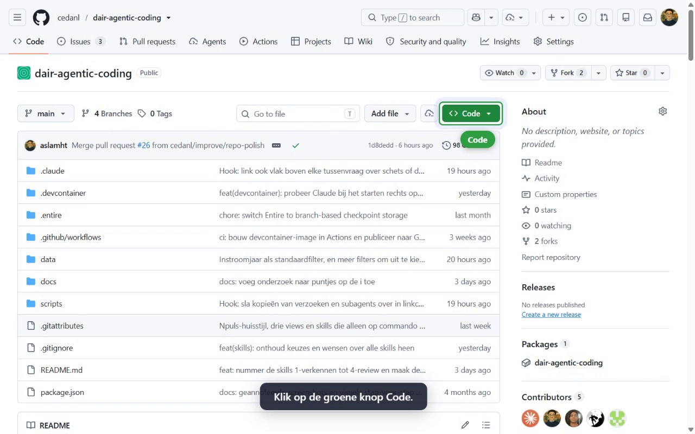
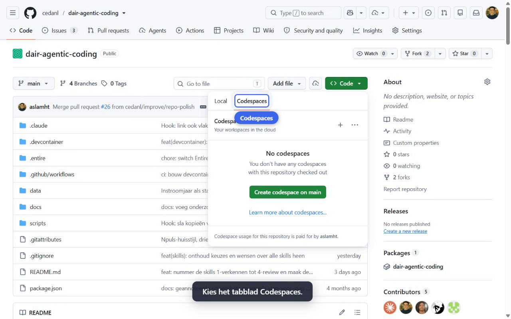
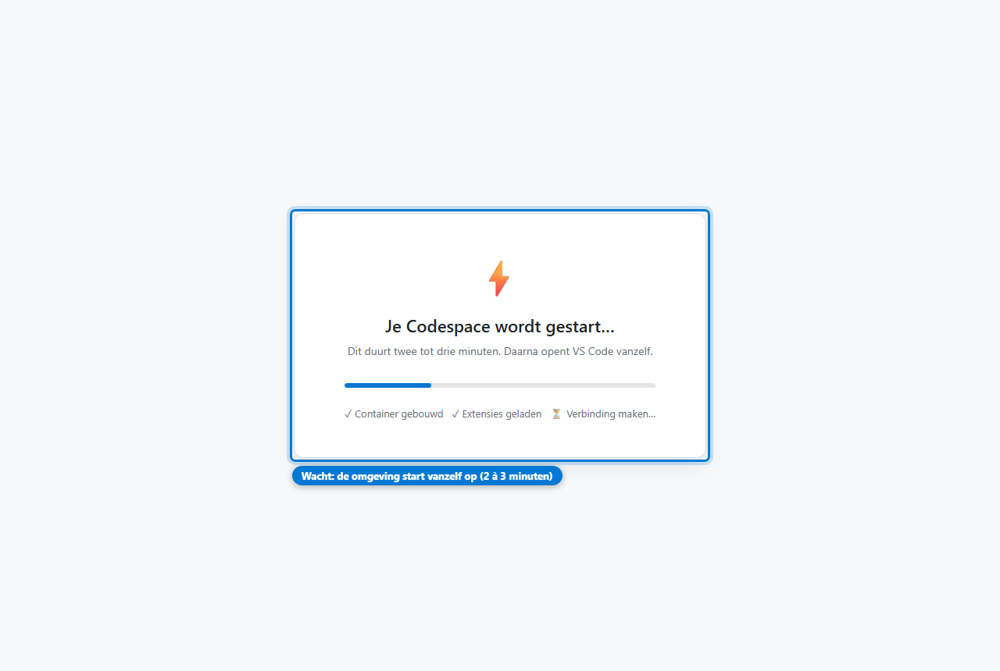
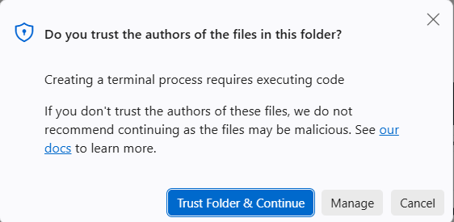
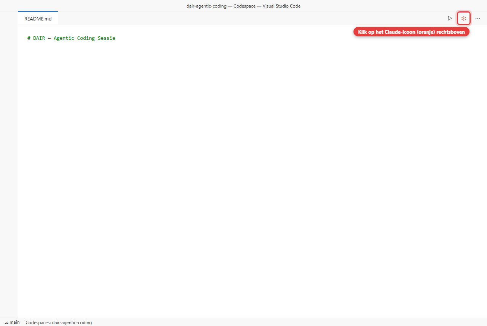
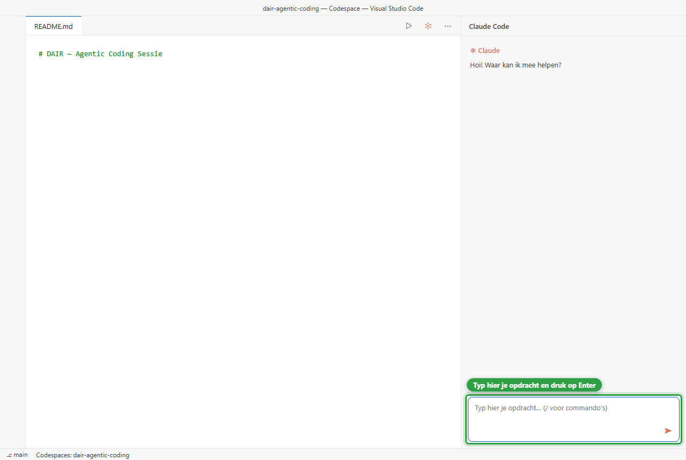

# DAIR — Agentic Coding Sessie

Welkom bij de agentic coding sessie. Je hebt geen lokale installatie nodig — alles draait in de browser via GitHub Codespaces.

---

## Aan de slag

### Stap 1 — Log in op GitHub

Ga naar [github.com](https://github.com) en log in met je eigen account. Heb je er nog geen? Maak er dan gratis een aan met **Sign up**.

---

### Stap 2 — Maak een Codespace aan

Klik op de groene knop **Code**, dan op de tab **Codespaces** en daarna op **Create codespace on main**.

---

### Stap 3 — Wacht tot de omgeving klaar is

De Codespace start vanzelf op. Dit duurt twee tot drie minuten. De workshop-key staat al klaar, je hoeft niets in te stellen.

Verschijnt de vraag **Do you trust the authors of the files in this folder?**, klik dan op **Trust Folder & Continue**. Zonder dat vertrouwen start de terminal niet. De bestanden komen uit de workshop-repo van CEDA.

---

### Stap 4 — Open het Claude-paneel

Klik op het **oranje Claude-icoon** rechtsboven in de editor. Het Claude-paneel opent aan de rechterkant.

---

### Stap 5 — Geef Claude een opdracht

Typ je opdracht in het vak onderaan het paneel en druk op **Enter**. Met `/` zie je alle beschikbare commando's en skills. Hieronder staat welke skills je in deze sessie gebruikt.

> Vraagt een terminal toch om een workshop-key? Roep de begeleider.

---

## De skills

Een skill is een werkwijze die Claude volgt. Je start er een met `/` en de naam. Skills starten alleen als je ze zelf typt; tijdens gewoon chatten springen ze niet vanzelf aan. In deze sessie gebruik je er drie, achter elkaar:

| Stap | Skill | Wat Claude doet | Wat je krijgt |
|---|---|---|---|
| 1 | `/verkennen_data` | Leert samen met jou de data kennen: wat de kolommen kunnen betekenen, hoe het staat met de datakwaliteit en de verdelingen, welke definities en privacyregels gelden, en welke ideeën er bij jouw vraag passen | `uitvoer/data-profiel.html` |
| 2 | `/schets_dashboard` | Schetst twee of drie grafieken (views) op papier, nog zonder code | `uitvoer/schets.html` |
| 3 | `/bouwen_dashboard` | Bouwt het dashboard, met een (schijn-)uploadscherm als eerste scherm, en test het daarna | Een dashboard dat je zelf opent |

**Hoe het werkt.** Claude stelt je vragen één voor één, elk met een standaardantwoord, of doet een voorstel. Antwoord "ok" of corrigeer wat niet klopt: jij beslist over de inhoud, Claude voert uit. De uitkomsten (HTML) komen in de map `uitvoer/`. Zie hieronder hoe je ze opent.

**Een HTML-bestand openen in Codespaces.** Klik met de rechtermuisknop op het bestand in de verkenner en kies **Show Preview**. De pagina opent in een nieuw tabblad van je browser; vraagt GitHub om door te gaan, klik dan op *Continue*. Zie je in plaats daarvan *This content is blocked*, dan opent de preview nog binnen VS Code: druk op `Ctrl+Shift+P` (Mac: `Cmd+Shift+P`) en kies **Live Preview: Show Preview (External Browser)**. Staat *Show Preview* er niet tussen, installeer dan de extensie **Live Preview** van Microsoft (`ms-vscode.live-server`) via het Extensions-paneel (`Ctrl+Shift+X`).

**Andere skills.** De drie skills verwijzen naar skills die CEDA ook in eigen projecten gebruikt en die in deze repo staan: `grafiekkeuze` (welke grafiek past) en `vormgever-npuls-huisstijl` (de Npuls-stijl). Je hoeft ze niet zelf te starten.

**Meenemen.** Claude zet niets in GitHub. Je Codespace is tijdelijk: wil je je werk houden, klik dan met de rechtermuisknop op het bestand in de verkenner en kies *Download*.

**De data.** De demodata (fictieve studenten) staat in `data/demodata_1cho.csv`. Heb je uitleg bij de data (een codebook, een omschrijving van de kolommen, een definitie), geef die dan aan Claude wanneer `verkennen_data` daarom vraagt. Heb je dat niet, dan leidt Claude de betekenis af uit de kolomnamen en vraagt het jou om te bevestigen. De skills zelf kennen geen 1CHO en werken ook met andere data. Het dashboard begint met een uploadscherm, zoals in een echte toepassing. Voor de workshop staat het bestand daar al klaar: je hoeft niets te downloaden of te uploaden, alleen op *Doorgaan* te klikken. Welk bestand het dashboard gebruikt, staat in het startcommando dat Claude je geeft.

Aan het einde van de sessie sluit je af met `/review-reflect` (zie hieronder).

---

## Review geven

Aan het einde van de sessie geef je je review **in Claude**: typ `/review-reflect`. Er opent een vragenlijst die je invult.

De review is anoniem en gaat naar de begeleiders. Je kunt een vraag overslaan.

---

## Hulp nodig?

Spreek een begeleider aan of stel je vraag hardop, dat is precies waar deze sessie over gaat.
