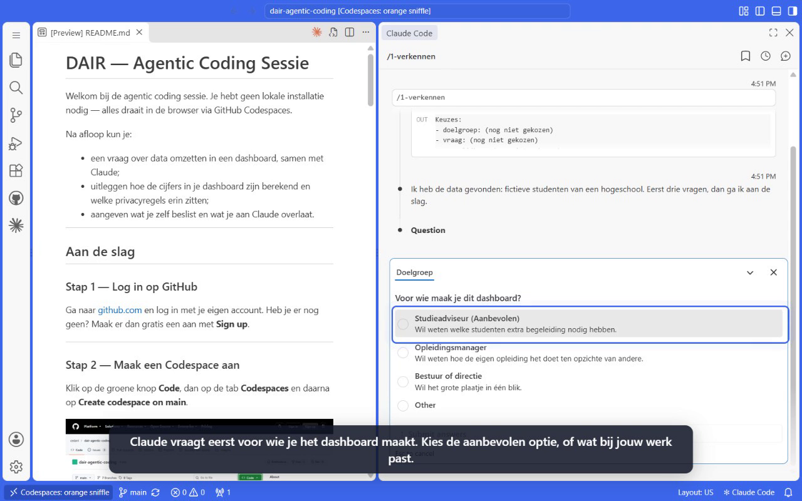

# DAIR — Agentic Coding Sessie

Welkom bij de agentic coding sessie. Je hebt geen lokale installatie nodig — alles draait in de browser via GitHub Codespaces.

Na afloop kun je:

- een vraag over data omzetten in een dashboard, samen met Claude;
- uitleggen hoe de cijfers in je dashboard zijn berekend en welke privacyregels erin zitten;
- aangeven wat je zelf beslist en wat je aan Claude overlaat.

---

## Aan de slag

### Stap 1 — Log in op GitHub

Ga naar [github.com](https://github.com) en log in met je eigen account. Heb je er nog geen? Maak er dan gratis een aan met **Sign up**.

---

### Stap 2 — Maak een Codespace aan

Klik op de groene knop **Code**, dan op de tab **Codespaces** en daarna op **Create codespace on main**.

---

### Stap 3 — Wacht tot de omgeving klaar is

De Codespace start vanzelf op. Dit duurt één tot drie minuten. De workshop-key staat al klaar, je hoeft niets in te stellen.

Verschijnt de vraag **Do you trust the authors of the files in this folder?**, klik dan op **Trust Folder & Continue**. Staat je browser in het Nederlands, dan heet de knop **Map vertrouwen en doorgaan**. Zonder dat vertrouwen verschijnt het Claude-icoon niet. De bestanden komen uit de workshop-repo van CEDA.

---

### Stap 4 — Open het Claude-paneel

Klik op het **oranje Claude-icoon** rechtsboven in de editor. Het Claude-paneel opent aan de rechterkant.

---

### Stap 5 — Start met de eerste skill

Typ `/1-verkennen` in het vak onderaan het paneel en druk op **Enter**. Claude stelt je dan drie vragen en gaat daarna aan de slag. Typ je `/` met het nummer, dan vult Claude de naam aan (`/1` wordt `/1-verkennen`). Hieronder staat wat elke skill doet.

> Vraagt een terminal toch om een workshop-key? Roep de begeleider.

---

## De skills

Een skill is een werkwijze die Claude volgt. Je start er een met `/` en de naam. Skills starten alleen als je ze zelf typt; tijdens gewoon chatten springen ze niet vanzelf aan. In deze sessie gebruik je er drie, achter elkaar:

| Stap | Skill | Wat Claude doet | Wat je krijgt |
|---|---|---|---|
| 1 | `/1-verkennen` | Leert samen met jou de data kennen: wat de kolommen kunnen betekenen, hoe het staat met de datakwaliteit en de verdelingen, welke definities en privacyregels gelden, en welke ideeën er bij jouw vraag passen | `data-profiel.html` |
| 2 | `/2-schetsen` | Schetst je dashboard in grijs: de grafieken (views), het filter en de titel, met de echte groepen en jaren maar nog zonder getallen. Hier pas je de opzet aan | `schets.html` |
| 3 | `/3-bouwen` | Bouwt het dashboard precies zoals je schets en vraagt of het klopt. Een kleine wens in tekst of kleur past Claude meteen aan; wil je iets anders zien, dan past Claude schets en dashboard samen aan | `dashboard.html` |

**De casus.** In `/1-verkennen` kies je eerst voor wie je het dashboard maakt en welke vraag het beantwoordt, en daarna waarop je vergelijkt. Elke combinatie levert één dashboard op. Op de slides staan de vragen in een andere volgorde; in Claude geldt deze.

| | Voor wie | Wil weten |
|---|---|---|
| A | Studieadviseur *(aanbevolen)* | Welke studenten extra begeleiding nodig hebben |
| B | Opleidingsmanager | Hoe de eigen opleiding het doet ten opzichte van andere |
| C | Bestuur of directie | Het grote plaatje in één blik |

| | Vraag | Vergelijken op |
|---|---|---|
| A | Wie stopt na het eerste jaar? *(aanbevolen)* | sector, opleiding of geslacht |
| B | Wie haalt binnen vijf jaar een diploma? | opleiding, vooropleiding of sector |
| C | Hangt stoppen samen met je vooropleiding? | vooropleiding (staat vast), daarnaast sector of geslacht |

In `/2-schetsen` kies je nog een filter, meestal het instroomjaar, en wat bovenaan komt.

**Hoe het werkt.** Claude stelt je vragen één voor één, met een paar opties om aan te klikken; de aanbevolen optie staat bovenaan. Klik een optie aan (mag je er meer kiezen, vink ze dan allemaal aan) en klik daarna op **Submit answers**, of kies **Other** en typ je eigen antwoord: jij beslist over de inhoud, Claude voert uit. De uitkomsten (HTML) komen in de hoofdmap, bovenaan in de verkenner. Zie hieronder hoe je ze opent.

**Een HTML-bestand openen in Codespaces.** Claude geeft je na elke stap een link: klik erop. Werkt de link niet, klik dan met de rechtermuisknop op het bestand in de verkenner en kies **Show Preview**. De pagina opent in een nieuw tabblad van je browser; vraagt GitHub om door te gaan, klik dan op *Continue*. Zie je in plaats daarvan *This content is blocked*, dan opent de preview nog binnen VS Code: druk op `Ctrl+Shift+P` (Mac: `Cmd+Shift+P`) en kies **Live Preview: Show Preview (External Browser)**. Staat *Show Preview* er niet tussen, installeer dan de extensie **Live Preview** van Microsoft (`ms-vscode.live-server`) via het Extensions-paneel (`Ctrl+Shift+X`).

**Andere skills.** De skills verwijzen naar `vormgever-npuls-huisstijl` (de Npuls-stijl), die CEDA ook in eigen projecten gebruikt en die in deze repo staat. Je hoeft hem niet zelf te starten.

**Meenemen.** Claude zet niets in GitHub. Je Codespace is tijdelijk: wil je je werk houden, klik dan met de rechtermuisknop op het bestand in de verkenner en kies *Download*. Naast `dashboard.html` staat `dashboard-berekeningen.py`: daarin kun je lezen hoe de cijfers zijn berekend. Download die er ook bij als je wilt kunnen terugkijken.

**De data.** De demodata (fictieve studenten van een hogeschool, in de opzet van 1CijferHO) staat in `data/demodata_1cho.csv`. Ernaast staat de casus, `data/demodata_1cho.casus.json`: de doelgroepen, vragen, definities en privacydrempels die de skills gebruiken (zie *De casus* hieronder). De skills werken ook met andere data, maar alleen als er zo'n casusbestand naast staat. Je hoeft niets te downloaden of te uploaden: het dashboard rekent met de demodata die al in de Codespace staat.

Aan het einde van de sessie sluit je af met `/4-review` (zie hieronder).

---

## Review geven

Aan het einde van de sessie geef je je review **in Claude**: typ `/4-review`. Claude geeft je een link naar de vragenlijst: klik erop en vul hem in je browser in.

De review is anoniem en gaat naar de begeleiders. Je kunt een vraag overslaan.

---

## Afsluiten: verwijder je Codespace

Je Codespace telt mee voor je gratis Codespaces-tegoed bij GitHub, ook als je hem niet gebruikt. Download eerst wat je wilt houden (zie *Meenemen*). Ga daarna naar [github.com/codespaces](https://github.com/codespaces), klik bij je Codespace op **···** en kies **Delete**.

---

## Hulp nodig?

Spreek een begeleider aan of stel je vraag hardop, dat is precies waar deze sessie over gaat.
